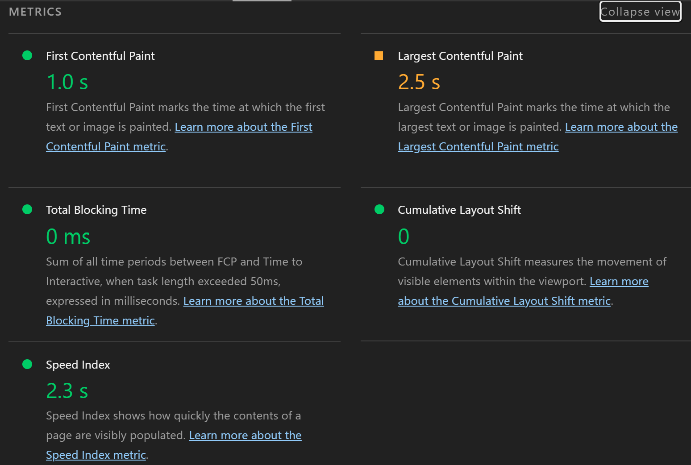
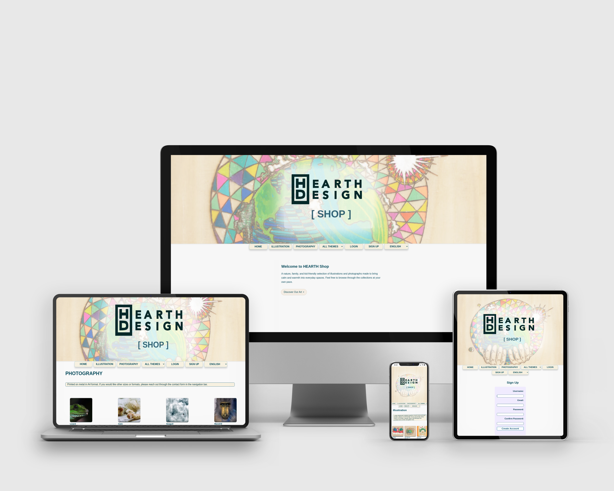
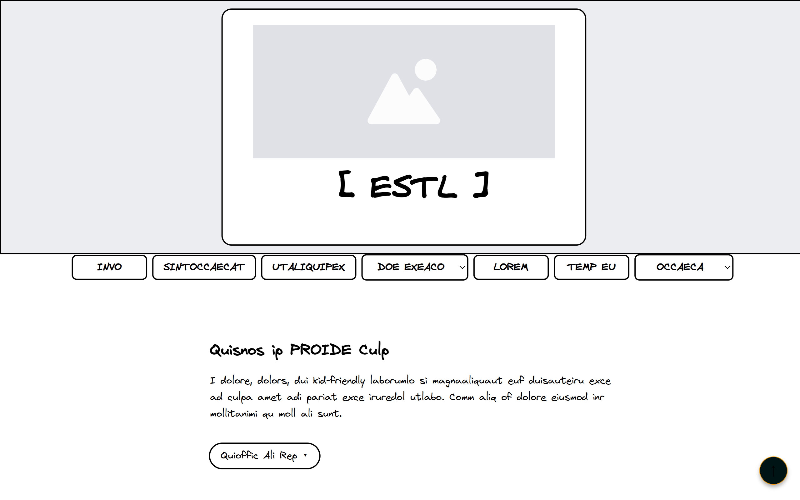
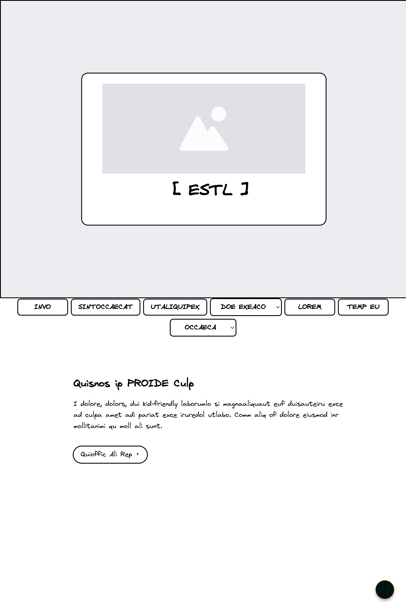
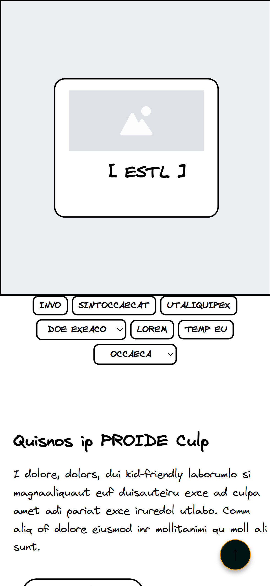
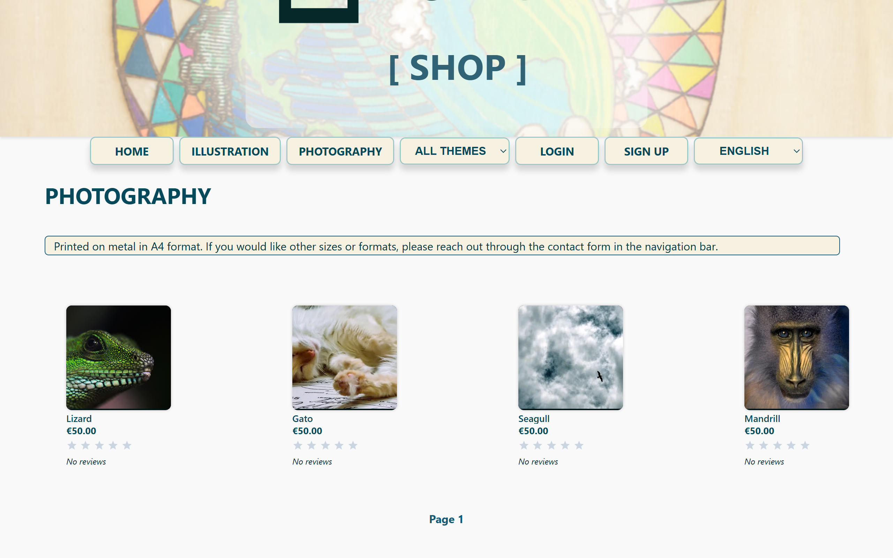
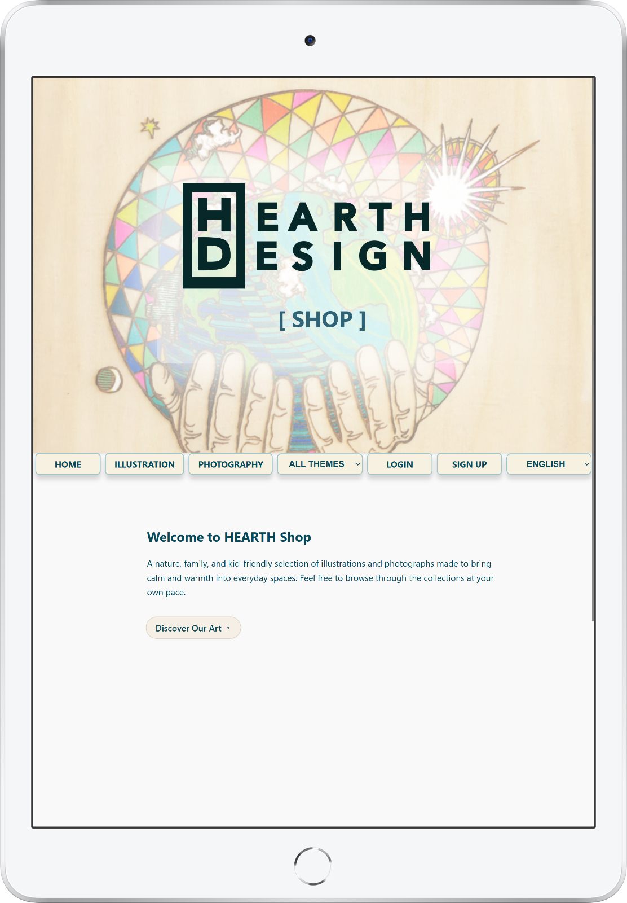
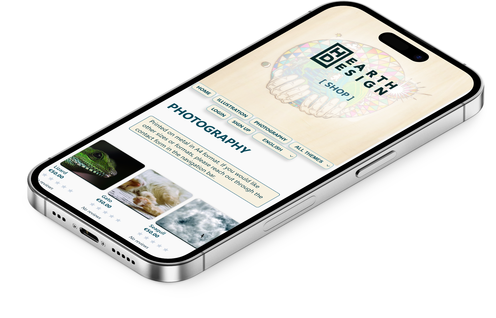
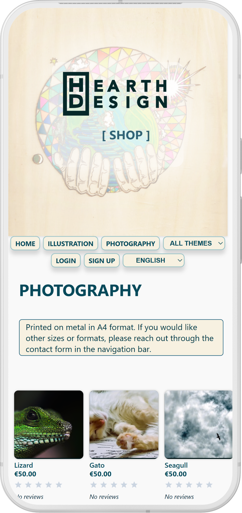

# HEARTH Shop

## A multilingual Django e-commerce application for selling photography prints and illustrations. 

The platform includes artwork browsing, theme-based filtering, shopping cart functionality, **Stripe**-powered payments, **Cloudinary** image hosting, **Supabase** document storage, and internationalization support.

---

## Table of Contents

- [Project Goals](#project-goals)
- [Business Model](#business-model)
- [Target Audience](#target-audience)
- [Value Proposition](#value-proposition)
- [Design, UX & Technical Architecture](#design-ux--technical-architecture)
- [Responsive Mockups, Wireframes & Device Testing](#responsive-mockups-wireframes--device-testing)
- [User Stories](#user-stories)
- [Features](#features)
- [Newsletter & Social Channels](#newsletter--social-channels)
- [Project Structure](#project-structure)
- [Core Data Model](#core-data-model)
- [Artwork Classification](#artwork-classification)
- [Installation](#installation)
- [Cloudinary Setup](#cloudinary-setup)
- [Neon DB Storage Setup](#neon-db-storage-setup)
- [Stripe Setup](#stripe-setup)
- [Heroku Deployment](#heroku-deployment)
- [Internationalization](#internationalization)
- [Manual Testing](#manual-testing)
- [Automated Testing](#automated-testing)
- [Validation Testing](#validation-testing)
- [PEP8 tested with Ruff (`charliermarsh.ruff`) extension](#pep8-tested-with-ruff-charliermarshruff-extension)
- [Project Documentation](#project-documentation)
- [License](#license)

---

## Project Goals

HEARTH Shop was created to provide artists with a dedicated platform for presenting, organizing, and selling original artwork online.

The project combines artwork management, cloud-based media delivery, secure payment processing, and multilingual support into a single e-commerce solution designed for both local and international audiences.

The platform prioritizes:

- Visual presentation of artwork
- Simple and intuitive browsing
- Efficient inventory management
- Secure online payments
- Scalable cloud storage
- International accessibility

Future development may include digital downloads, limited-edition collections, artist collaborations, and print-on-demand integration.

---

## Business Model

HEARTH Shop follows a direct-to-consumer (D2C) e-commerce model focused on the sale of original photography and illustration prints.

Revenue is generated through:

- Physical print sales
- Limited stock artwork collections
- Curated themed collections
- Potential future commissioned artwork services

The platform enables the artist to manage pricing, inventory, themes, and product presentation while maintaining full ownership and control over the catalog.

Potential future revenue streams include:

- Limited editions
- Seasonal collections
- Exclusive releases
- Digital artwork downloads
- Commissioned artwork
- Artist partnerships

---

## Target Audience

HEARTH Shop is designed for:

### Art Enthusiasts

Customers seeking original photography and illustration prints for personal collections.

### Home Decor Buyers

Individuals looking for artwork to decorate:

- Living rooms
- Bedrooms
- Offices
- Creative workspaces

### Gift Buyers

Customers searching for meaningful and visually distinctive gifts.

### International Customers

Visitors who benefit from multilingual navigation and purchasing experiences.

### Interior Designers and Small Galleries

Professionals sourcing artwork for styling, exhibitions, staging projects, and interior design concepts.

---

## Value Proposition

HEARTH Shop combines:

- Curated artwork collections
- Theme-based artwork discovery
- Secure online purchasing
- International accessibility
- Professional media delivery through Cloudinary
- Reliable cloud storage infrastructure
- Inventory and order management

The platform provides customers with an engaging shopping experience while giving administrators full control over catalog organization, pricing, stock, and content management.

---

## Design, UX & Technical Architecture

### Target Audience & Brand Positioning

- **Family- & Children-Friendly Experience:** Designed as an approachable, welcoming online print gallery suitable for households, families, and younger visitors. The tone, visuals, and copy avoid aggressive sales clutter in favor of warmth, curiosity, and clear storytelling.
- **Calm, Gallery-Inspired Atmosphere:** Soft linen and parchment tones evoke fine art paper and studio framing, while deep coastal teal keeps the interface grounded, trustworthy, and soothing so artwork remains the focal point.
- **Editorial Storytelling:** A pill-shaped **Discover** toggle on the homepage introduces the brand's story and artist inspiration in a clean, expandable panel without overwhelming first-time visitors.

### Usability, Navigation & Readability

- **Simple, Predictable Structure:** Pages follow a consistent vertical rhythm—hero/header, focused main content area, and a soft-toned footer—making browsing, cart management, and order history intuitive for users of all ages.
- **Omnipresent Navigation Bar:** A persistent, responsive top navbar keeps core actions (browsing, cart, account, theme, and language selection) visible and accessible across viewports, wrapping cleanly on smaller screens.
- **Effortless Long-Page Browsing:** A floating **Back to Top** button appears as users scroll through the print gallery, offering one-click return navigation without losing context.
- **Clear Visual Hierarchy & Typography:** Uses a clean sans-serif font stack (`'Segoe UI', sans-serif`) paired with fluid `clamp()` sizing so headings, print titles, prices, and star ratings scale legibly across desktop, tablet, and mobile devices.

### Color Palette, Contrast & Accessibility

- **High-Contrast Color Pairings:**
  - **Primary Ink & Headings (`#05495a` / `rgb(5, 73, 90)`):** Deep marine teal ensures strong text legibility against light backgrounds.
  - **Interactive Controls & Inputs (`#145a78` / `rgb(20, 90, 120)`):** Brighter ocean teal distinguishes labels, inputs, placeholders, and active hover states.
  - **Warm Parchment & Linen Surfaces (`#f7f1e1`, `#f6efe6`, `#faf6f0`, `#f9f3eb`):** Soft pastel backgrounds reduce eye strain compared to stark white while framing navigation pills, buttons, and story panels.
  - **Clean Canvas & Card Neutrals (`#f9f9f9` & `#ffffff`):** Neutral cards and blurred-backdrop modals isolate product photography cleanly.
  - **Warm Amber Accents (`#f59e0b`, `#ffcf7d`):** Highlights review ratings and the dark-slate back-to-top control (`rgb(0, 20, 22)`).
- **Inclusive Accessibility:**

```css 
/* Example: Fluid heading scale, accessible focus ring, and reduced-motion support */
.hearth-title {
  font-size: clamp(1.5rem, 4vw, 4rem);
  color: rgb(5, 73, 90);
}

.discover-trigger:focus-visible {
  outline: 2px solid #5c4f42;
  outline-offset: 3px;
}

@media (prefers-reduced-motion: reduce) {
  .discover-trigger,
  .discover-cue,
  .about-dropdown-panel:not([hidden]) {
    transition: none;
    animation: none;
  }
}
```
  
  - **Native Language Names in Navbar:** Language options preserve their native names (e.g., *English*, *Italiano*, *Español*, ) across all 8 supported locales (`en`, `es`, `de`, `fr`, `it`, `ja`, `pt`, `zh_Hans`) so any visitor can immediately recognize and switch to their language.
  - **Keyboard & Motion Care:** Includes visible `:focus-visible` outlines, screen-reader-only labels (`.visually-hidden`), and `@media (prefers-reduced-motion: reduce)` rules to disable animations for motion-sensitive users.

### Application Architecture & Data Integrity

- **Modular Domain Separation (`checkout` app):** Cart, order, and Stripe checkout models and views (`Cart`, `CartItem`, `Order`, `OrderItem`) are isolated in a dedicated `checkout` app, keeping `shop` focused on catalog and gallery functionality.
- **Zero-Downtime Database Compatibility:** Extracted models retain their original database table names (`shop_cart`, `shop_cartitem`, `shop_order`, `shop_orderitem`) via `Meta.db_table` for seamless compatibility with the existing Neon PostgreSQL database.
- **Internationalization Workflow:** Translation catalogs are audited and compiled via `makemessages` and `compilemessages` across all 8 locales, paired with dedicated app test suites and a clean branch-to-`main` deployment workflow for GitHub and Heroku.

---

### Responsive Mockups, Wireframes & Device Testing

To ensure a welcoming, family- and children-friendly browsing experience across every screen size, HEARTH Shop was planned from low-fidelity wireframes to responsive multi-device layouts. Across desktop, tablet, and mobile viewports, the homepage maintains clear visual hierarchy, high-contrast marine teal typography (`#05495a` / `#145a78`) over warm parchment and linen surfaces (`#f7f1e1`, `#f6efe6`, `#faf6f0`), and uninterrupted access to navigation and language controls.

#### Multi-Device Homepage Mockup
The multi-device mockup demonstrates how the homepage adapts seamlessly from widescreen monitors to tablets and smartphones while preserving artwork legibility and calm gallery pacing.

<!-- IMAGE SLOT: Multi-device mockup (Desktop + Tablet + Mobile) showing the homepage -->


- **Hero Banner & Brand Framing:** The full-width hero header scales fluidly using `clamp()` sizing, pairing the translucent frosted card backdrop with the brand logo and title so the artwork remains inviting without visual clutter.
- **Editorial Storytelling (`Discover` Toggle):** Positioned cleanly below the hero, the pill-shaped **Discover** button (`border-radius: 999px`) expands the brand's story and artist quote panel without crowding smaller screens.
- **Omnipresent Navigation Bar:** Core links (galleries, cart, account, theme filter, and language switcher) stay accessible at the top of the viewport, wrapping neatly on compact screens and keeping native language names (e.g., *English*, *Italiano*) recognizable for every visitor.

---

#### Wireframes (Planning & Structural Blueprints)
Early wireframes established the predictable vertical rhythm shared across all pages—persistent top navigation, focused main content area, and a soft-toned footer—so visitors of all ages can browse prints, inspect details, and complete checkout effortlessly.

| Viewport | Structural Focus | Key Layout Decisions |
| :--- | :--- | :--- |
| **Desktop Wireframe** | Spacious gallery grid & wide hero framing | Multi-column square (`1:1`) print grid (`max-width: 1400px`), horizontal navbar pills, and centered hero focal point. |
| **Tablet Wireframe** | Balanced touch targets & wrapping controls | Fluid two-to-three column grid adaptation and wrapped navigation controls with comfortable spacing. |
| **Mobile Wireframe** | Single-column clarity & thumb-friendly navigation | Stacked cards, compact navbar pills (`0.8rem`), full-width modal previews, and floating **Back to Top** button. |

<!-- IMAGE SLOT: Desktop, Tablet, and Mobile Wireframes -->
| Desktop Wireframe | Tablet & Mobile Wireframes |
| :---: | :---: |
|  |  |  |

---

#### Live Screen Captures Across Devices
Real-device and browser viewport tests verify that **Cloudinary**-hosted artwork thumbnails, blurred-backdrop detail modals (`backdrop-filter: blur(4px)`), and **checkout** flows render consistently without layout shifts.

<!-- IMAGE SLOT: Live Desktop & Mobile Homepage Screenshots -->
| Desktop Homepage (`1440px`) | Tablet View (`768px`) | Mobile View (`375px`) |
| :---: | :---: | :---: |
|  |  |  |  |

- **Interactive Artwork Modal:** Tapping any print card opens a centered preview modal with quantity selection and direct **Add to Cart** actions backed by the isolated `checkout` app and **Neon DB** persistence.
- **Accessible Long-Page Navigation:** As visitors scroll through the gallery on mobile or desktop, the floating **Back to Top** button provides immediate return access alongside visible keyboard focus states (`:focus-visible`) and `prefers-reduced-motion` support.

---

## USER STORIES

### Customer

Customer
   |
   +--> Browse Prints
   +--> Filter Themes
   +--> Contact Artist
   +--> Purchase Print

As a customer, I can:

  - Browse available prints and artwork collections.
  - View artwork details including title, image and price.
  - Filter artwork by theme and medium.
  - Add items to a shopping cart.
  - Complete purchases through Stripe Checkout.
  - View previous orders from my account.
  - Switch between supported languages.

### Shop Administrator

Administrator
   |
   +--> Manage Prints
   +--> Manage Themes
   +--> Manage Orders

As a shop administrator, I can:

  - Create and manage prints.
  - Upload artwork images and supporting documents
  - Assign themes and categories.
  - Manage pricing and stock levels.
  - Activate or deactivate artwork listings.
  - Review customer contact submissions.
  - Monitor orders and payment activity.
  
---

## Features

### Artwork Management. **Prints : Illustrations, Photography**

Manage photography and illustration prints through a centralized `Print` model.

  - Artwork titles and descriptions
  - Pricing and stock management
  - Theme assignment
  - Category assignment
  - Active/inactive visibility control

### Photography & Illustration Galleries

 Browse artwork by type using dedicated gallery views.

  - Photography gallery
  - Illustration gallery
  - Modal image preview
  - Pagination
  - Theme filtering


### **Themes & Categories**
**Artwork organization is handled through two classification layers:**

### Themes

Describe the subject of an artwork:
- Nature
- Animals
- Architecture
- Family
- Abstract

### Categories

Organize website content:
- Print
- Blog
- Info

### Cloudinary Image Hosting

Cloudinary is used for:
- Print images
- Category images
- Theme icons
  
### **Neon-DB Storage Integration**  

  Uses `django-storages` with Neon-DB endpoint for:
  - Manuals
  - Documents
  - Backup files

- **Stripe Checkout**  
  Secure payment flow with Stripe Checkout Sessions.

### **Shopping  Cart & Orders**  
 
 Features include:
  - Persistent cart storage (`Cart`, `CartItem`)
  - Order creation
  - Order history
  - Stripe Checkout Sessions payment flow

### **Multilingual Support**  
  Templates use `` and `` for i18n.
```django


```

- **Reusable Templates**  
  Shared `_gallery_grid.html` and `_pagination.html` snippets, plus `base_gallery.html`.

---

### Newsletter & Social Channels

### Newsletter & Social Channels

- **Mailchimp Newsletter Signup:** Integrated into the site footer (`base.html`) so visitors can subscribe to updates on new illustrations, prints, and shop releases via Mailchimp (including a hidden honeypot field to deter bots).
```text
Browser
   |
Django
   |
PostgreSQL

Cloudinary <-- Images

Mailchimp <-- Newsletter
```

- **Facebook Link Omitted:** No live Facebook link is included in the storefront UI; social links are intentionally left out until an official public page is active.


---

## Project Structure

```text
# Project Structure

```text
hearth_design/
│
├── manage.py
├── Procfile
├── README.md
├── requirements.txt
├── .gitignore
├── .python-version
├── .env
│
├── docs/
├── media/
├── static/
├── staticfiles/
├── hearth_shop/
├── shop/
└── hvenv/
```

<details>
<summary><strong>📁 docs</strong></summary>

```text
docs/
├── user_stories.md
├── project_workflow.md
├── manual_testing.md
└── automated_testing.md
```

</details>

<details>
<summary><strong>📁 media</strong></summary>

```text
media/
└── prints/
    ├── 1003/
    └── 2025/
```

</details>

<details>
<summary><strong>📁 static</strong></summary>

```text
static/
└── placeholder.txt
```

</details>

<details>
<summary><strong>📁 staticfiles</strong></summary>

```text
staticfiles/
├── admin/
│   ├── css/
│   ├── images/
│   └── js/
│
├── cloudinary/
│   ├── html/
│   └── js/
│
├── django_extensions/
├── css/
│   └── style.css
│
├── js/
├── images/
├── favicon.ico
└── placeholder.txt
```

</details>

<details>
<summary><strong>📁 hearth_shop (Django Project)</strong></summary>

```text
hearth_shop/
├── __init__.py
├── settings.py
├── urls.py
├── asgi.py
├── wsgi.py
├── __pycache__/
│
├── static/
│   ├── css/
│   │   └── style.css
│   │
│   ├── js/
│   │   └── main.js
│   │
│   ├── images/
│   │   ├── android-chrome-192x192.png
│   │   ├── favicon-32x32.png
│   │   └── ...
│   │
│   ├── sounds/
│   ├── favicon.ico
│   └── site.webmanifest
│
└── templates/
    ├── base.html
    │
    └── includes/
        └── navbar.html
```

</details>

<details>
<summary><strong>📁 shop (Django Application)</strong></summary>

```text
shop/
├── __init__.py
├── admin.py
├── apps.py
├── context_processor.py
├── forms.py
├── models.py
├── tests.py
├── urls.py
├── views.py
│
├── storage_cloudinary.py
├── storage_backups.py
│
├── __pycache__/
├── locale/
├── migrations/
│
├── management/
│   └── commands/
│       └── migrate_images_to_print.py
│
├── services/
│   ├── cart.py
│   ├── checkout.py
│   ├── stripe.py
│   └── webhooks.py
│
└── templates/
    │
    ├── registration/
    │   ├── login.html
    │   ├── signup.html
    │   ├── logged_out.html
    │   ├── password_change_form.html
    │   ├── password_change_done.html
    │   ├── password_reset.html
    │   ├── password_reset_done.html
    │   ├── password_reset_confirm.html
    │   ├── password_reset_complete.html
    │   └── password_reset_email.html
    │
    └── shop/
        ├── homepage.html
        ├── illustration_gallery.html
        ├── photography_gallery.html
        ├── themed_gallery.html
        ├── cart.html
        ├── order_history.html
        ├── contact.html
        ├── thank_you.html
        ├── upload.html
        ├── payment_success.html
        ├── checkout_thanks.html
        ├── payment_cancel.html
        └── _pagination.html
```

</details>

<details>
<summary><strong>📁 hvenv</strong></summary>

```text
hvenv/
├── include/
├── Lib/
├── Scripts/
└── pyvenv.cfg
```

</details>
```
> The placeholder file exists only to ensure Git tracks the static directory structure.

---

## Core Data Model

```
hearth_design/
├── docs/
├── hearth_shop/ ← Django project package
├── shop/            ← Django application
├── media/
├── static/
├── manage.py
├── README.md
├── Procfile
└── requirements.txt
```

```text
Category
    └── Organises site content (Print, Blog, Info)

Theme
    └── Describes artwork subjects
        (Nature, Animals, Architecture, etc.)

Print
    ├── title
    ├── slug
    ├── type (photo | illustration)
    ├── image
    ├── description
    ├── price
    ├── stock
    ├── themes
    ├── category
    └── is_active

Cart
    └── CartItem
            └── Print

Order
    └── OrderItem
            └── Print
```
---
## Artwork classification

### Print.type
Defines the artistic medium:
  - `photo`
  - `illustration`

### Theme
Defines the artwork subject:

  - Nature
  - Animals
  - Architecture
  - Family
  - Abstract

### Category
Defines the subject of a section:
- Artworks (Prints)
- Blog (future development)

## Single Source of Truth
The `Print` model acts as the single source of truth for:

- Title
- Description
- Image
- Price
- Stock
- Themes
- Artwork Metadata
---

## Installation

### 1. Clone the Repository

```bash
git clone https://github.com/hearthdesign/hearth_design.git
cd hearth-shop
```

### 2. Install dependencies

```bash
pip install -r requirements.txt
```

#### Requirements include:

annotated-types==0.7.0
anyio==4.12.1
asgiref==3.9.1
boto3==1.42.65
botocore==1.42.65
brotli==1.2.1
cachetools==6.2.6
certifi==2025.8.3
cffi==2.0.0
charset-normalizer==3.4.3
click==8.3.1
cloudinary==1.44.1
colorama==0.4.6
cryptography==46.0.5
deprecation==2.1.0
dj-database-url==3.0.1
Django==5.2.6
django-cloudinary-storage==0.3.0
django-extensions==4.1
django-storages==1.14.6
fsspec==2026.2.0
gunicorn==23.0.0
h11==0.16.0
h2==4.3.0
hpack==4.1.0
httpcore==1.0.9
httpx==0.28.1
hyperframe==6.1.0
idna==3.10
jmespath==1.1.0
markdown-it-py==4.0.0
mdurl==0.1.2
mmh3==5.2.1
multidict==6.7.1
packaging==25.0
pillow==11.3.0
postgrest==2.28.0
propcache==0.4.1
psycopg==3.2.10
pycparser==3.0
pydantic==2.12.5
pydantic_core==2.41.5
Pygments==2.19.2
pyiceberg==0.11.1
PyJWT==2.11.0
pyparsing==3.3.2
pyroaring==1.0.3
python-dateutil==2.9.0.post0
python-decouple==3.8
python-dotenv==1.1.1
realtime==2.28.0
requests==2.32.5
rich==14.3.3
s3transfer==0.16.0
six==1.17.0
sqlparse==0.5.3
storage3==2.28.0
StrEnum==0.4.15
strictyaml==1.7.3
stripe==12.5.1
supabase==2.28.0
supabase-auth==2.28.0
supabase-functions==2.28.0
tenacity==9.1.4
typing-inspection==0.4.2
typing_extensions==4.15.0
tzdata==2025.2
urllib3==2.5.0
websockets==15.0.1
whitenoise==6.11.0
yarl==1.23.0
zstandard==0.25.0

---

### 3. Configure environment variables

Create a `.env` file:

```env
SECRET_KEY=your_django_secret
DEBUG=True

## Database
DB_NAME=postgres
DB_USER=your_db_user
DB_PASSWORD=your_db_password
DB_HOST=db.<project>.supabase.co
DB_PORT=5432

## Cloudinary
CLOUDINARY_CLOUD_NAME=your_cloud_name
CLOUDINARY_API_KEY=your_api_key
CLOUDINARY_API_SECRET=your_api_secret

## Stripe
STRIPE_SECRET_KEY=sk_test_xxx
STRIPE_PUBLISHABLE_KEY=pk_test_xxx
```
---

### 4. Apply Migrations

```bash
python manage.py migrate
```

### 5. Run the Development Server

```bash
python manage.py runserver
```

---

## Cloudinary Setup

Cloudinary is used to store and deliver all public-facing images.

### Create a Cloudinary Account

1. Create an account at https://cloudinary.com
2. Open the Cloudinary Dashboard.
3. Obtain:

- Cloud Name
- API Key
- API Secret

### Add Credentials to `.env`

```env
CLOUDINARY_CLOUD_NAME=your_cloud_name
CLOUDINARY_API_KEY=your_api_key
CLOUDINARY_API_SECRET=your_api_secret
```

Cloudinary handles:

  - Print images
  - Category images
  - Theme icons

---

## NEON-DB Storage Setup

NEON-DB is used for document and backup storage.

1. Go to NEON-DB Dashboard 

2. Navigate to
→ Storage → Configuration → S3.

3. Generate:
  - Access Key ID 
  - Secret Access Key.

4.  Create a bucket (e.g. media) and set it to Public (for images visibility)
    Open your project in the **Neon Console** and copy your PostgreSQL connection string (or host, database name, user, password, and `sslmode=require`).


5. Add the connection details to `.env` (and to Heroku config vars when deploying):

```env
DATABASE_URL=postgresql://<user>:<password>@<neon-hostname>/<dbname>?sslmode=require
```

---

## Stripe Setup

1. Create a Stripe account.

2. Obtain:
  - Publishable Key (pk_...)
  - Secret Key (sk_...)

1. Add them to .env as:
```env
STRIPE_SECRET_KEY=sk_test_xxx
STRIPE_PUBLISHABLE_KEY=pk_test_xxx
```

> **Important:** Do not reverse the keys.
> - Secret keys begin with `sk_`
> - Publishable keys begin with `pk_`

Update `success_url` and `cancel_url` to match your deployment domain.


## Heroku Deployment

### Login and Create Application
```bash
heroku login
heroku create
```

### Deploy
```bash
git push heroku main
```

### Configure environment variables:
```bash
heroku config:set SECRET_KEY=...

heroku config:set CLOUDINARY_CLOUD_NAME=...
heroku config:set CLOUDINARY_API_KEY=...
heroku config:set CLOUDINARY_API_SECRET=...

heroku config:set STRIPE_SECRET_KEY=...
heroku config:set STRIPE_PUBLISHABLE_KEY=...
```

### Apply migrations:
```bash
heroku run python manage.py migrate
```

### Collect static files:
```bash
heroku run python manage.py collectstatic --noinput
```

### Verify deployment:
Open the Application

```bash
heroku open
```

---

## Internationalization

The application supports multiple languages using Django's built-in translation framework.

### In the Templates 
Translations are implemented using:

```django


```

### Configure languages in settings.py:

```python
USE_I18N = True
LANGUAGES = [
    ('en', 'English'),
    ('de', 'Deutsch'),
    ('fr', 'Français'),
    ...
]
```

---

# Manual Testing

## Gallery

| Test | Expected Result | Pass |
|--------|--------|--------|
| Open gallery page | Gallery loads correctly | ✅ |
| Open modal | Larger image opens | ✅ |
| Change language | Language changes | ✅ |
| Add to cart | Product added correctly | ✅ |

### Reusable Templates
_gallery_grid.html → renders thumbnails. 
_pagination.html → renders pagination links.
base_gallery.html → includes both in blocks for reuse.

Specialized templates (homepage.html, illustration_gallery.html, photography_gallery.html, themed_gallery.html) extend base_gallery.

## Testing Locally

### Artwork Upload
  - Upload a print through Django Admin or the upload form.
  - Verify that images are stored in Cloudinary.

### Gallery Views

- Browse photography and illustration galleries.
- Test pagination.
- Test theme filtering.

### Shopping Experience

- Add items to the cart.


- Update quantities.


- Remove items.


### Checkout

- Complete a Stripe test transaction.


- Verify order creation.


- Confirm order history functionality.


- Payment Cancelled


---

# Automated Testing

## Django Tests

Run:
python manage.py test

Result:
All tests passed successfully.

---

# Validation Testing

## HTML Validation

All pages were validated using the W3C HTML Validator.
Minor warnings were reviewed and deemed acceptable where applicable.

## CSS Validation

The stylesheet was tested using the W3C CSS Validator.

Result:

- 0 CSS errors
- Remaining warnings relate to browser-supported vendor extensions and intentional styling choices.

Validator:
https://jigsaw.w3.org/css-validator/


---

## JSHint results

Result

Metrics

There are 23 functions in this file.
Function with the largest signature take 4 arguments, while the median is 0.
Largest function has 15 statements in it, while the median is 4.
The most complex function has a cyclomatic complexity value of 6 while the median is 2.

---

## Lighthouse


### Passed audits (21)

- Use efficient cache lifetimes
- Layout shift culprits
- Optimize DOM size
- Duplicated JavaScript
- Font display
- Forced reflow
- INP breakdown
- LCP request discovery
- Legacy JavaScript
- Modern HTTP
- Optimize viewport for mobile
- Minify CSS
- Reduce unused CSS
- Reduce unused JavaScript
- Avoids enormous network payloads Total size was 200 KiB
- User Timing marks and measures
- JavaScript execution time 0.1 s
- Minimizes main-thread work 0.6 s
- Avoid non-composited animations
- Image elements have explicit width and height
- Page didn't prevent back/forward cache restoration


Passed audits (21)

- [aria-*] attributes match their roles
- [aria-hidden="true"] is not present on the document <body>
- [aria-*] attributes have valid values
- [aria-*] attributes are valid and not misspelled
- Image elements have [alt] attributes
- [user-scalable="no"] is not used in the <meta name="viewport"> element and the [maximum-scale] attribute is not less than 5.
- Select elements have associated label elements.
- ARIA attributes are used as specified for the element's role
- [aria-hidden="true"] elements do not contain focusable descendents
- Elements use only permitted ARIA attributes
- Background and foreground colors have a sufficient contrast ratio
- Document has a <title> element
- <html> element has a [lang] attribute
- <html> element has a valid value for its [lang] attribute
- Links have a discernible name
- Lists contain only <li> elements and script supporting elements (<script> and <template>).
- List items (<li>) are contained within <ul>, <ol> or <menu> parent elements
- Touch targets have sufficient size and spacing.
- Heading elements appear in a sequentially-descending order
- Document has a main landmark.
- Elements with role="none" or role="presentation" do not have conflicts


Passed audits (13)

- Uses HTTPS
- Avoids deprecated APIs
- Avoids third-party cookies
- Allows users to paste into input fields
- Avoids requesting the geolocation permission on page load
- Avoids requesting the notification permission on page load
- Displays images with correct aspect ratio
- Serves images with appropriate resolution
- Page has the HTML doctype
- Properly defines charset
- No browser errors logged to the console
- No issues in the Issues panel in Chrome Devtools
- Page has valid source maps


Passed audits (8)

- Page isn’t blocked from indexing
- Document has a <title> element
- Document has a meta description
- Page has successful HTTP status code
- Links have descriptive text
- Links are crawlable
- Image elements have [alt] attributes
- Document has a valid hreflang

---

### HTTPS Testing

The application enforces HTTPS in production using Django security settings:

- SECURE_SSL_REDIRECT
- SECURE_PROXY_SSL_HEADER
- Secure session cookies
- Secure CSRF cookies

Testing confirmed that HTTP requests are automatically redirected to HTTPS.

---

## PEP8 tested with **Ruff** (`charliermarsh.ruff`) extension 

```python
ruff check .
```

### After running the first test the following problems have been found:

### 1. Unused variable created:
```python
cart, created = Cart.objects.get_or_create(
user=request.user
)
```

Has been changed to:
```python
cart, _ = Cart.objects.get_or_create(
user=request.user
)
```

### 2. Unused variable event:
```python
event, status_code = handle_stripe_webhook(
payload,
sig_header
)
```

Has been changed to:
```python
_event, status_code = handle_stripe_webhook(
payload,
sig_header
)
```

### 3. Translation warning (INT001):
```Python
message = _(
f"Hi {form.cleaned_data['name']},\n\n"
"Thank you for reaching out..."
)
```
Wrong for Django i18n.

Has been replaced with:

```python
message = _(
"Hi %(name)s,\n\n"
"Thank you for reaching out to us. "
"We've received your message and will get back to you shortly.\n\n"
"Best regards,\n"
"Hearth Design Team"
) % {
"name": form.cleaned_data["name"]
}
```

### 4, Variable name change:

The variable "created" has been replaced with "_created"

### After executing the test (ruff check .)

Result:
All checks passed!

---

## Project Documentation

Additional documentation is available in the `docs/` directory:

docs/
├── user_stories.md
├── project_workflow.md
├── automated_testing.md
└── manual_testing.md

---

## License

This project is licensed under the MIT License.

See the `LICENSE` file for details.

