# Hearth Shop — Manual Testing

Areas tested:

- Navigation
- Internationalisation
- Theme filtering
- Authentication
- Cart functionality
- Checkout flow
- Contact form validation
- Responsive layouts

**Manual testing completed.**

Results:

All critical user journeys completed successfully.
Theme filtering verified across all supported languages.
Language switching verified without data loss.
Automated tests: 13 passed.
Manual tests: completed successfully.

## US-01 Audit Existing Application

### Test Case 1

Objective
Verify application runs locally.

Steps

1. Activate virtual environment.
2. Run server.

Expected Result
Homepage loads correctly.

Actual Result
Homepage loaded successfully.

Status
Pass

## US-02 Browse Product Catalogue

### Test Case 1

Objective
Verify products display correctly.

Steps
1. Open homepage.
2. Open gallery page.

Expected Result
Products display names, images and prices.

Actual Result
Products displayed correctly.

Status
Pass

---

PHOTOGRAPHY GALLERY
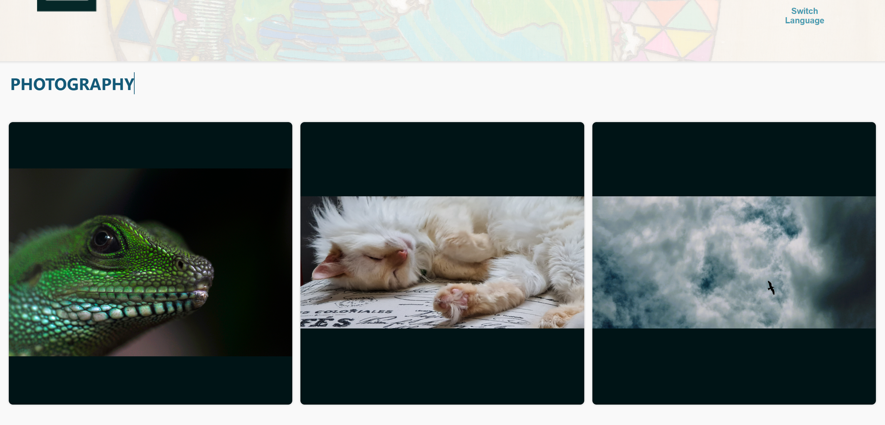

ILLUSTRATION GALLERY
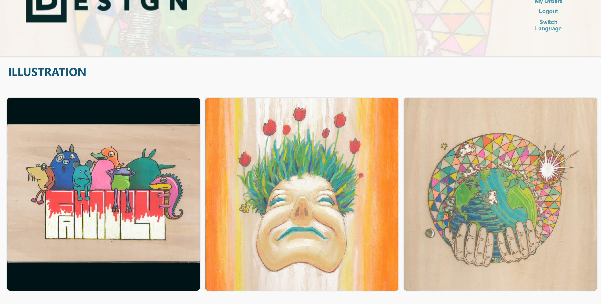

LANGUAGES
ENGLISH

ITALIAN
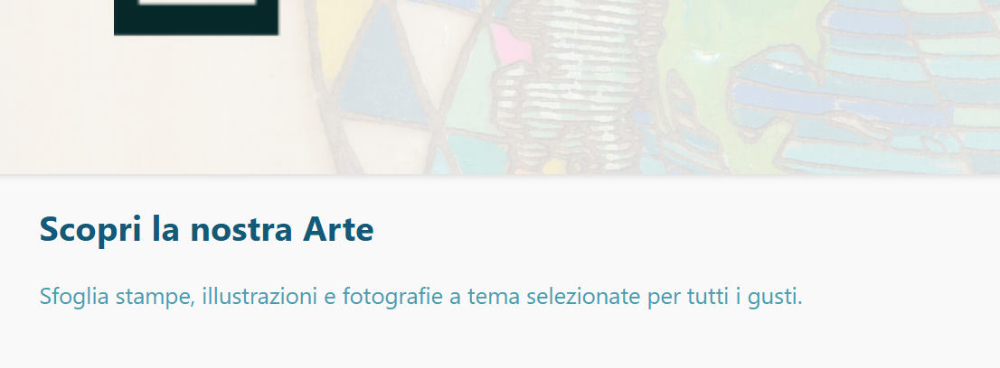
GERMAN
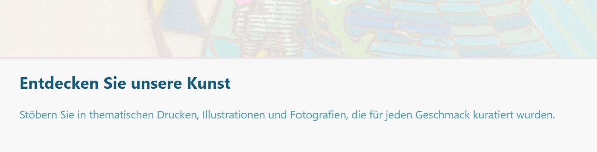
FRENCH
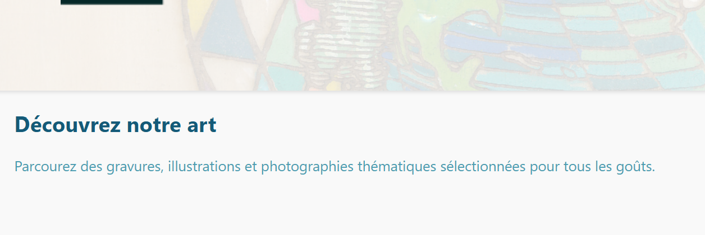
PORTUGUESE
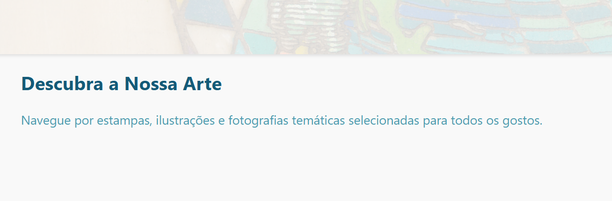
JAPANESE
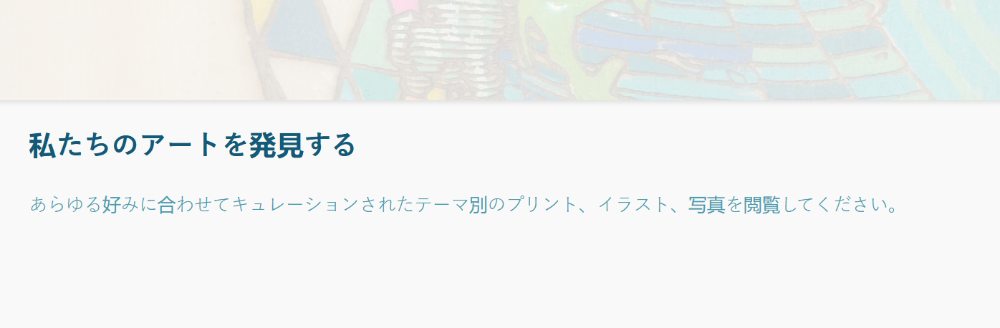
CHINESE
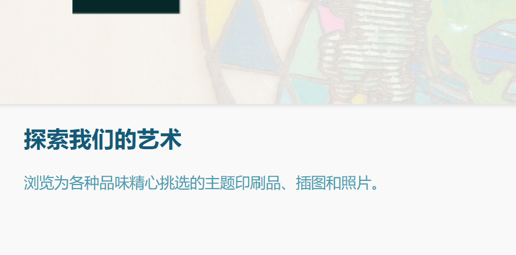

Internationalisation applies to:

- Navigation
- Buttons
- Forms
- Validation messages
- Page titles
- Ecommerce workflow
- Cart
Stripe Checkout Verification


### Test Case 1

Objective

Verify that a successful Stripe checkout creates an order.

Steps

Add a print to the cart.
Proceed to checkout.
Complete payment using a Stripe test card.
Allow Stripe webhook processing.

Expected Result

Order created successfully.
Order appears in Order History.
Payment marked as paid.

Actual Result

Order was created successfully and displayed in Order History.

Status

Pass

---

### Test Case 2

Objective

Verify that completed orders clear the shopping cart.

Steps

Add products to cart.
Complete checkout.
Return to cart.

Expected Result

Cart is empty after payment.

Actual Result

Cart was cleared successfully.

Status

Pass

--- 

### Test Case 3

Objective

Verify duplicate Stripe webhook events do not create duplicate orders.

Steps

Trigger webhook processing.
Re-submit the same Stripe session.

Expected Result

Only one order exists for the Stripe session.

Actual Result

Duplicate order creation prevented successfully.

Status

Pass

---

- Contact form

Artwork titles and theme names remain editor-defined content and are not translated.

CHECK OUT
CART

PAYMENT
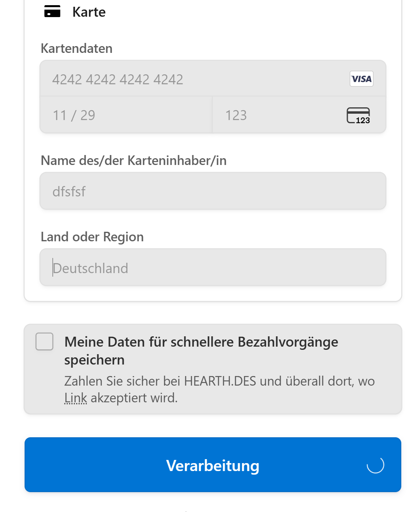

PAYAMENT CONFIRMATION
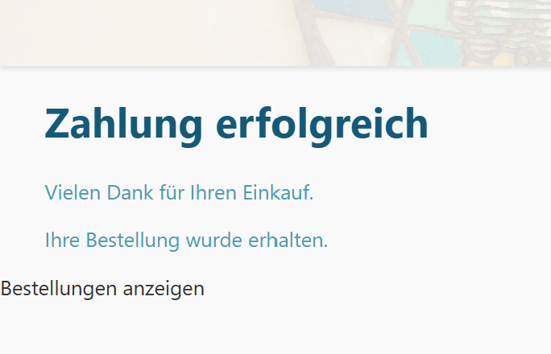

ORDER
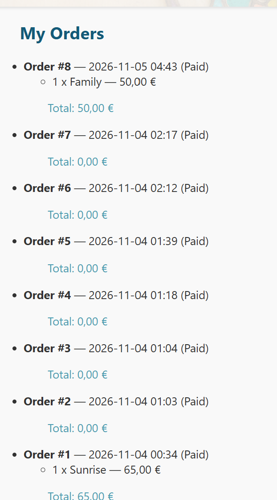

REGISTRATION

LOGIN

UPLOAD IMAGES

---

## System Validation

### Django System Check

**Objective**

Verify that the Django project configuration contains no configuration, application, template, middleware, URL routing, or model issues.

**Command**

```bash
python manage.py check
```

Expected Result
System check identified no issues (0 silenced).

Actual Result
System check identified no issues (0 silenced).